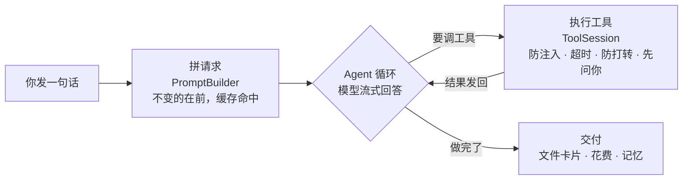
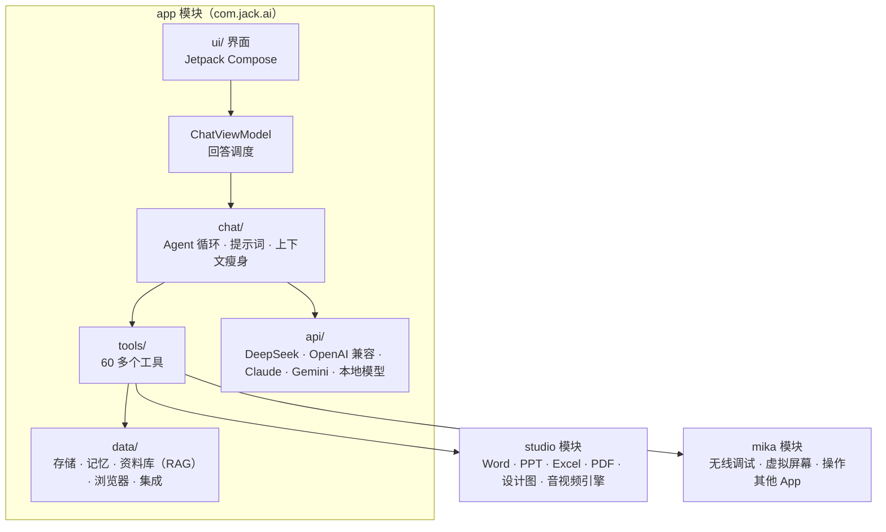
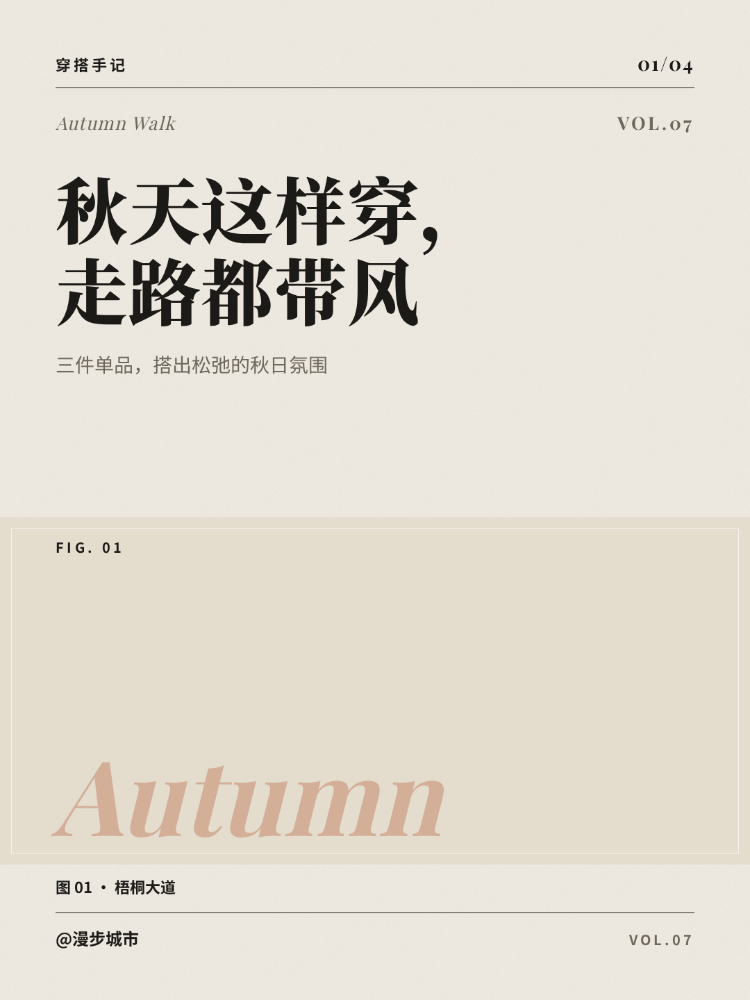
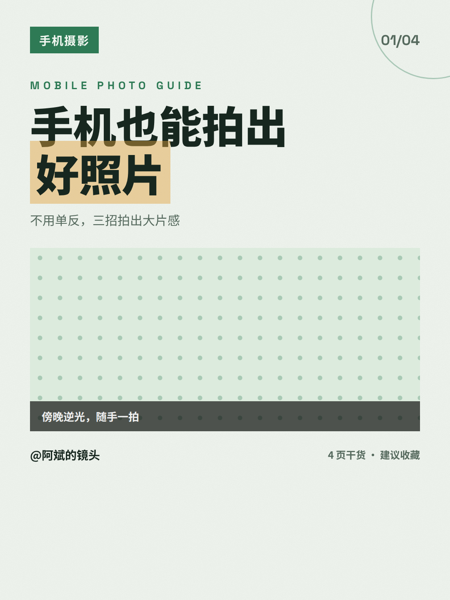
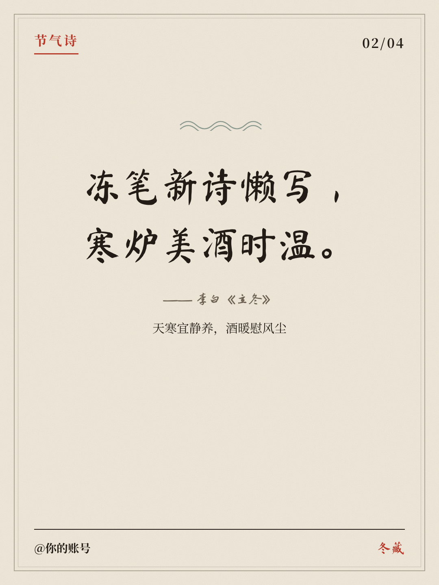
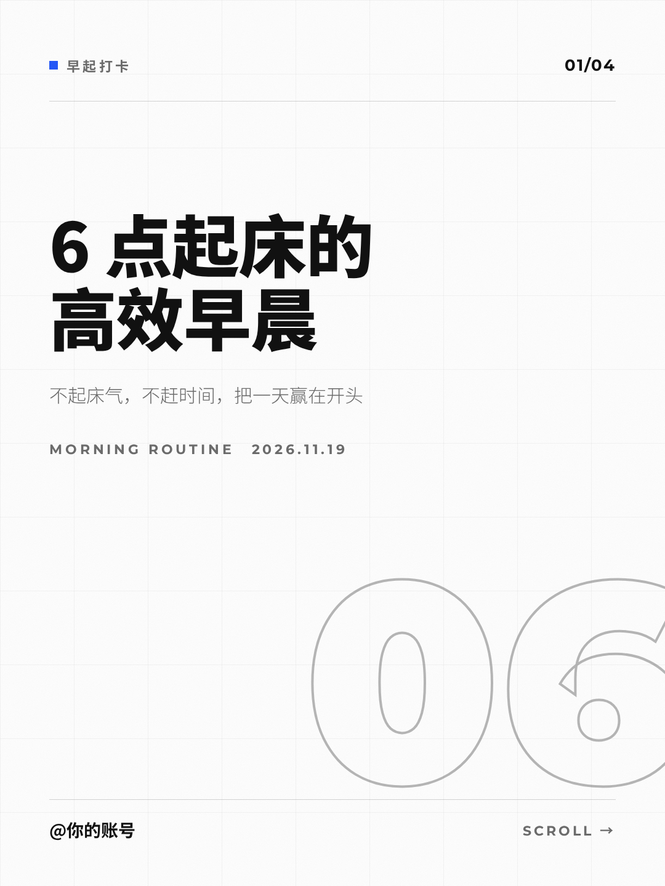
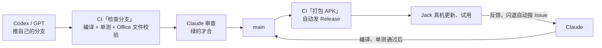

# Kavi

**An Android AI agent that chats, remembers and gets things done on your phone.**
**一个能聊天、有记忆、会在手机上动手做事的安卓 AI 助手。**

默认用 DeepSeek，也能接入任何 OpenAI 兼容的模型服务，以及 Claude、Gemini 的原生接口。能聊天，也能动手做事：做 Word / PPT / 设计图 / 视频，开浏览器查资料、在后台操作别的 App，记住你说过的事。

## 10 秒看懂

### 一条消息怎么变成做完的事

做任务时 Kavi 边做边调工具，做完就交付；中途你插一句话它当场改方向，网络断了自动重试，被系统杀掉后台接着做。

### 架构

### 做出来的东西

内置设计模板的渲染预览（同一套引擎，Kavi 做小红书配图、海报时用它排版）：

更多见 [design-previews/](design-previews/)。

## 功能

### 对话
- 流式输出，随时停止；最多 3 个对话同时回答（各答各的，停一个不影响别的；要确认的事排队一个一个问；浏览器同一时间给一个用，别的排队等；通知栏合成一条进度）；普通对话 / 深度思考一键切换，可查看思考过程
- 思考时像 GPT 一样显示进度：一行行思考摘要（后台模型把每段思考压成小标题），加上 Kavi 调工具前说的一句「我先查一下……」，按先后串成一列；回答一开始，原始思考收进「深度思考」，摘要默认还展开着（设置 → 模型和思考里可以改成折叠，也能关掉摘要）
- 防提示词注入：网页、邮件、文件、连接器读回来的内容先过一遍代码检测（不花 token）：藏起来的字删掉，冲着 AI 下指令的句子原样保留但标出来，并提醒 Kavi 拒绝照做、继续你的任务；回答下面告诉你在哪读到的。这一轮接下来存记忆、点网页、提交、发送这类往外做的事都先问你；开着完全授权就不问，只报告一句。拦下的记录在统计页能看
- 一种对话，聊天和做事都在里面：平常照常聊；碰到要好几步才能做完的事，Kavi 自己转成做事的做法，交付前自己核对一遍硬要求；出错先分清是哪类问题再换办法；长任务自动压掉旧的大段工具结果，省上下文；网络断了、服务一时忙停下的，过一会儿自动接着做（连着最多 3 次）；长任务压掉的旧工具结果全文存进文件，要细看直接读回来，不用重新搜；做完列出交付清单：这一轮新建、改动（加删了几行）、删除了哪些文件
- 记忆不分家：每个对话都带全局记忆；做任务时学到的（踩过的坑、交付习惯、常用路径）记进所有对话共用的「做事经验」，在对话的「记忆」里能看能改；以前的 Work 对话都变成普通对话
- 记忆连成网：每条记忆标着涉及谁、什么（人、地方、项目……）和什么时候的事；聊到某个人，关于他的记忆一起想起来；说「上周」「去年国庆」按时间找，附上那段时间聊过什么；记忆页能按人和事筛、看关系图
- 记忆空间：按场景分开记（默认「生活」，可以加「工作」「生意」……），每个对话选一个，只用、只记这个空间的记忆，夜间整理也分开
- 设置里填上怎么称呼你，Kavi 回答时、心里想事时都用你的名字
- 两种 DeepSeek 模型：Flash（快、便宜、能看图）和 Pro（V4.1-Pro 发布前官方暂时转给 Flash）
- 接入其他模型服务（Kimi、通义、智谱、豆包、硅基流动、OpenRouter、OpenAI 等）：填地址和 Key 自动列出可用模型，勾选后在顶部随时切换；硅基流动只填 Key、不选模型也能保存（用来转文字和按意思找回忆）；通义的免费额度能自动探测（设置 → 免费额度池，先在百炼控制台给模型开「免费额度用完即停」，免得用完开始扣费）
- Markdown、代码、表格、数学公式渲染
- 复制、重新回答、删除消息、编辑已发的消息重新提问、一键复核（用 V4.1 Flash 严格检查上一条回答并给出改进版）
- 版本切换：改了消息重发、点重新回答，旧的回答不丢，消息下面出现「‹ 2/3 ›」左右切着看（一处最多留 8 个版本）；对话文件夹跟着走：重发前文件先退回这条消息发出时的样子，免得在上一版改坏的文件上接着做，切回旧版本时它做出来的文件也一起回来（文件太多太大的文件夹不退回；思路参考 Operit）
- 长对话自动压缩成「前情提要」，需要时还能翻回原话
- 人设（系统提示词）预设，可自己添加
- 粘贴长文变文件：一次往输入框里贴超过 1500 字（文章、聊天记录、代码），自动存成一个 .txt 附件，输入框不卡、对话里不刷屏
- 拍照提问，或发图片、PDF、Word、文本文件给它看；也可以从别的 App「分享」进来
- 语音输入、朗读回答（默认用手机自带的朗读；设置 → DeepSeek API Key 里能改用 DeepSeek 语音，女声或男声，1.5 元/万字符）
- 语音对话：长按麦克风按钮（或「＋」→ 语音对话），说完停一下它就自动发出去，回答写完读给你听，读完接着听，不用一直按；想插话点「打断」，说够了点「结束」。不用手机自带的语音识别，用「转文字」的服务（DeepSeek Key 就能用）；回答会说得短一点、口语一点。开着时屏幕不灭，切到别的 App 就不听了
- 问题卡片：说得模糊、Kavi 拿不准你要什么时，不瞎猜，给几张能点的问题卡片（每张都能「其他（我自己说）」）；写完文案也给几个修改方向点着选（口语一点、短一点、加个优惠……）
- 做生意：新对话空白页上点一下就开始写小红书笔记、产品介绍、发营销朋友圈（入口沉在页面底部、靠近输入框；抖音脚本、回客户消息、报价单直接跟 Kavi 说）；Kavi 用卡片问清楚卖什么、多少钱、卖给谁，问过的店名、产品、价格、客户记下来，下次不再问（设置里能关掉这些入口）

### 生成文件
- Word、PPT、Excel、PDF；Word 可加封面（主色横幅）、自动目录（带页码、点了能跳）、标题自动编号（一、/（一）或 1 / 1.1）、页眉、「第 X 页 / 共 Y 页」页脚、首行缩进、宋体黑体的正式风格，表格表头着色、隔行浅底、数字靠右、跨页重复表头；Word 里也能插原生图表（双击改数）和配图（对话里的图片或自动搜图），自动加「图 1」图注；Excel 表头着色、冻结首行、自动筛选、隔行浅底，1,234、12%、¥12.50、2026-10-14 都存成真的数带格式，可加合计行、条件格式（超标标红、前几名标绿、包含某字标黄、数据条）和指着表格数据的原生图表；表格的照片、截图能直接变成 Excel（手机上离线识别文字，按位置排回行列，再对照原图核对）；PPT 有 13 种版式（封面、目录、章节、要点、卡片、两栏对比、时间线、大数字、流程、图表、金句、大图、结尾）；图表是原生的（柱状、横条、折线、饼图、环形图），数据内嵌，在 WPS、PowerPoint 里双击就能改数；每页自动写演讲稿，放映时在备注里看；发一份自己的 PPT 说「照着这个风格做」，会读出它的配色和字体照着来；「我的模板」：满意的风格（配色、字体、转场、封面信息、目录编号这些）存下来，以后说「用我的模板」就行，设成默认的话不说也照它来；生成过的 Word、PPT、Excel 能局部改：「第 3 页换成卡片版式」「删掉第 5 页」「整份换成红色」「Word 加上目录」「明细表加合计和图表」，只动要改的部分；PPT、Word 做完或改完，Kavi 会把每页截图自己看一眼（模型能看图时），发现溢出、太挤、太空、看不清就自己按页改；Word、PDF、文章能转成 PPT（重排大纲、数字变图表、细节进讲稿），PPT 也能转成讲稿或报告 Word（读得到每页的讲稿和图表数据）、9 套配色、200 多个矢量图标（Lucide，跟着配色变色），字多了自动缩字号、太挤会提醒 Kavi 精简或拆页；翻页转场（淡入、推入、擦除、分割、覆盖、缩放、平滑）和条目逐个出现的动画（淡入、上浮、擦出），在 WPS、PowerPoint 放映时可见；自动配图
- 设计图（像 Canva）：小红书配图和成组卡片、朋友圈方图、海报、邀请函、贺卡、名片、公众号封面、长图；套模板改字、换配色、放你的照片，或者让 Kavi 从头排版；小红书一篇拆成一组（封面、内页、结尾）一次出完，风格统一、页码自动编；出 PNG（要打印再出一份 PDF）；抠图去背景出透明 PNG（手机上的 BiRefNet-lite 模型，MIT，第一次用时选小巧版 82MB 或高清版 92MB 下载）
  - 风格库：大字报、杂志编辑、奶油温柔、多巴胺、极简白、手账拼贴、知识卡片、胶片复古、国风、科技暗色、高级黑金、学习笔记、日系清新、报纸 14 种，每种定好字体、字号、配色（各 2～3 套）、版式、装饰和禁忌；版式 10 种（封面、清单、步骤、对比、宫格、金句、大图、大数字、问答、结尾）和风格自由组合
  - 字体：内置得意黑；思源黑体（细到特粗）、思源宋体、霞鹜文楷、站酷快乐体、站酷黄油体、站酷小薇、马善政毛笔、志莽行书、刘建毛草、龙藏体，和几款英文字体，第一次用时联网下载（只下用到的字），以后离线也能用
  - 自动检查：文字装不装得下、跑没跑出画布，加上审美检查（字太小、对比度低、彩色太多、字体太多、贴边、标题不突出、大段居中、字太多、蓝紫渐变这类 AI 味）；Kavi 再看一眼成品和信息流缩略图，不及格先改
  - 编辑器：图下面点「编辑」自己动手改：点一下选中，拖动，两指缩放旋转，或者拖四角手柄缩放、拖顶上圆点旋转、拖文字框右边改宽；拖动时自动对齐画布边、中线、安全边距和别的元素（粉色参考线）；长按多选，一起移动，一键左中右、上中下对齐，等距分布；锁定、方向键微调、缩放角度透明度加减；双击文字直接在图上改，选中几个字单独换颜色、加粗、划荧光笔、加下划线；样式面板调字号、行距、字距，加描边、硬投影、软阴影、荧光底、反白块，套大标题、小标题、正文、标签预设；字改长了装不下自动缩字号；能加新的文字框；字体、粗细、对齐、底色、层级、换照片、隐藏，整张一键换配色，撤销重做；照片能在框里拖动缩放裁剪，套滤镜（胶片、清新、暖阳、冷调、鲜艳、褪色、黑白），调亮度、对比度、饱和度、色温，加蒙层让压在上面的字更清楚，改圆角、圆形、描边、阴影；一键抠图去背景；成组的图在一个编辑器里翻页改，缩略图条上长按复制、移动、删除页，换配色可以整组一起换，「同步到整组」统一配色和字体，页码自动重排，整组一键存进相册；保存后聊天里的图跟着变，之后再让 Kavi 改也接得上。最终目标见 [docs/设计编辑器_目标.md](docs/设计编辑器_目标.md)，接下来的元素库、和 Kavi 一起改、图层和版本见 [docs/设计编辑器_后续三步.md](docs/设计编辑器_后续三步.md)
  - 加元素：编辑器里没选中东西时点「加元素」，四个页签：形状（矩形、圆、星形、气泡、箭头、波浪线……能加描边）、贴纸（150 个：胶带、手绘箭头、圈画、标签、印章、边框、花草、节日……，能搜）、图标（几千个，中文搜「电话」「咖啡」就行）、纹理（纸纹、颗粒、网格、点阵、斜线，三档浓淡）；预览用这张图自己的配色，加进来能拖、缩放、换色、删除、撤销，整张换配色时跟着变。Kavi 从头做图时也会用这些贴纸
- 审美（技能）：做设计图、封面、PPT 时让它更好看、不带 AI 味：按内容挑风格，没说风格时先出两三张不同风格的封面让你挑（风格试衣间）；排版硬规矩（一个焦点、三档字号、对齐、留白、60/30/10 配色、最多两种字体）；出图后按清单打分自评，不及格就改；「高级点」「活泼点」「字太多」「没重点」这类说法对应固定的改法；你说过的喜好记下来。思路借鉴 baoyu-xhs-images（MIT）、impeccable（Apache-2.0）、qiaomu-design（MIT）、paper-signal（MIT），做法是自己写的
- 技能和插件分开：技能页上面是「技能」（做某一类活的方法：小红书运营、小红书视觉导演、一稿多发、抖音、闲鱼、广告合规、合同挑坑、视频分镜、生图提示词、小说、去 AI 味、深度研究、学习、求职、销售，加上从 GitHub 装的、你自己写的、Kavi 自己总结的，标出来源），下面是「插件」（自带的工具：Word、PPT、Excel、PDF、邮箱、日历、浏览器、表格、Python……）。插件不进技能清单，Kavi 直接调工具，第一次用到时自动带上用法；技能每轮按你这句话的意思挑出最相关的一两个提示给模型（用硅基流动或手机上的本地向量模型，不花模型调用），技能一多也不容易挑错。销售的记客户、参谋、复盘合成一个「销售」技能，浏览器流程并进「操作浏览器」插件
- 小红书运营（技能）：找选题（搜小红书的最热和联想词、看首页推荐流在推什么，对照抖音、B 站、YouTube 字幕、X，每个候选压成「对象 + 动作 + 情绪 + 读者得到什么」，列成选题库）、拆爆款（标题钩子、封面、开头、结构、结尾、评论区六块，值得留的记进「小红书爆款拆解」表；「照着这篇做」只学结构和风格，不抄原文原图）、诊断自己的号（最近 9～15 篇按定位、内容结构、互动、辨识度、能不能持续五项打分，落到最大优势、最大短板、下一篇改什么）、写标题正文话题（写完自己过一遍去 AI 味）、做封面和一篇拆成一组的卡片、在小红书 App 里填好停在「发布」前等你点头、按 24 小时和 3 天的数据复盘；也带做虚拟资料的选品、对标、制作、上架和合规红线（只卖原创、不承诺收益、不站外导流）。不批量发帖、不自动点赞关注评论。思路参考了 Agent-Reach、xhs-visual-director、baoyu-xhs-images、xiaohongshu-mcp、xhs-virtual-product 等开源项目，做法是自己写的
- 小红书视觉导演（技能）：封面和成组卡片。先按内容类型、给谁看、信息多少判断配哪种风格（说明为什么、不选哪种），列每页的任务和版式（封面、痛点、方法、例子、清单、总结、结尾，相邻两页不用同一种版式），封面按内容挑版式（大字钩子、大数字、左右对比、一句论断、大图、目录），可以一次出几版挑；张数多时每 3～4 张插一张整页金句、大数字或大图；先出封面样图给你看，点头再一次出完整组；整组锁定配色、字体、页码角标，出完按清单逐页自查（像不像 PPT、字多不多、哪页不统一）；也能审你现成的图、写给 AI 生图工具的 3:4 封面提示词。思路来自 ziguishian/xhs-visual-director-skill 和 JimLiu/baoyu-skills 的 baoyu-xhs-images（都是 MIT），按 Kavi 的设计工具重写
- 长视频切片（技能）：一条长访谈、播客、直播回放、课程切成几条能直接发的短视频：转成带时间的文字稿，按开头 1.5 秒有没有钩子（一句狠话、有表情的人脸）、能不能单独看懂、具体不具体（人名、数字、反差）、完不完整打分，挑出最好的几条，每条出竖屏成片（上面两行标题条：设定 + 「人名 + 做了什么 / 数字」，下面字幕）、封面、标题、简介和话题，其余列成备选；别人的内容会提醒版权和标出处。挑片段的规矩来自 zhouxiaoka/autoclip 对 158 条短视频的研究（MIT）：决定播放的是选哪一段和标题，花字、推近、音效高播低播都在用
- 出片质检：make_video 出完自动量响度，差得多就把声音调到平台标准的 -14 LUFS（只重做声音，画面原样拷贝，调大时不让它爆音），还会找黑屏（尤其第一帧黑，平台会拿它当封面）和超过 2 秒没声音的地方，写进结果让 Kavi 改。思路来自 KyaniteLabs/kinocut（Apache-2.0）和 autoclip
- 工作笔记：长任务（查很多资料、分好几步）里 Kavi 把查到的结论和出处、做过的决定、走不通的路记进对话文件夹的「工作笔记.md」；任务被打断接着做、对话被压缩后，先看笔记，细节不丢。思路来自 OthmanAdi/planning-with-files（MIT）
- 动画短片（技能）：不用视频生成，Kavi 用代码一帧帧画出 15～90 秒的动画：知识讲解、数据变化（柱子长出来、数字滚动）、金句文字动画、产品介绍、片头；十几种画风（极简大字、杂志编辑、数据新闻、手绘白板、黑板粉笔、霓虹夜、纸片拼贴、渐变流体、蓝图、复古胶片、像素、扁平图标）。先写分镜脚本给你看，配好音按每句的时间排镜头，先截几帧预览给你看画面，满意了再出 MP4，最后合上配音、配乐、音效和字幕；改哪个镜头直接说。竖屏 30 秒大约画一两分钟，要开着 App。思路来自 lemomo-ai/lemo-opuscar，代码和风格说明是自己写的
- 图解（技能）：把道理、流程、对比、数据画成一张干净的信息图：四象限、时间线、步骤、对比、漏斗、金字塔、韦恩图、飞轮、鱼骨图、用户旅程、泳道、组织架构、分层、桑基、甘特、百格图等二十多种，按要表达的关系选图型；删到最多 9 个框，强调色只给一两处，不用阴影渐变，连线横平竖直；出 PNG 放进小红书卡片、PPT、公众号；给个网址能取那个网站的配色，以后的图都用它。思路来自 cathrynlavery/diagram-design（MIT）
- 发帖草稿卡片：Kavi 写好的小红书笔记、朋友圈、微信消息、微博、抖音文案、公众号，在聊天里按那个平台发出去的样子显示（小红书是 3:4 图片加标题正文话题，朋友圈是九宫格，微信是绿色气泡），下面能「复制」「去发」（文字先复制好，带着图直接打开那个 App）「改一下」；超了平台限制（标题 20 字、正文 1000 字、18 张图）会提醒 Kavi。只是预览，不替你发。思路来自 assistant-ui/tool-ui（MIT）
- 一稿多发（技能）：丢一篇文章或一条视频（X 长文、公众号、网页、B 站、YouTube、抖音、自己写的稿子），Kavi 取原文（视频读字幕或转文字）、先读懂再按骨架改写一次，再出小红书卡片、手机长图、公众号文章（加头图）、口播稿，最后给一份发布清单和几个备选标题；也能原文照排（一个字不改只分页）。转述别人的不写成「我」，作者说的和 Kavi 归纳的分开标，图上的数字都要有出处，用 check_rewrite 对着原文查一遍数字和人称，每一版都署原作者。思路来自 threerocks/article2media（MIT）
- 去 AI 味（技能）：发一篇稿子说「去去 AI 味」，Kavi 先出检测报告：句子长短太均匀、段首过渡词多这类整体毛病，加上逐条命中的原句（「不是 A，而是 B」、「核心是：」这种下结论的冒号、一口气列四五项、三连排比、名词前一长串定语、套话、破折号太多），再自己读一遍挑出不贴切的比喻；你点头了才改，只改同意的那几处、最小改动，你自己的写作习惯优先，改完另存一份并复测给前后对比。规则是自己写的，依据「躺在废墟里」公开的同题配对实验结论（lieflat-less-ai-tone）
- 广告合规审查（技能）：发之前问「这篇能发吗」「有没有违禁词」，Kavi 按平台（小红书、公众号、抖音、视频号、朋友圈、详情页）和行业（医疗、食品、化妆品、金融、教培等）查极限词、功效宣称、没出处的数据、贬低同行、收益和效果承诺，图片和口播里的字也算；逐句给出原句、问题、依据的法条或平台规则、档位（必须改 / 看情况 / 建议改）和能照抄的改法，最后说「不能发 / 改完可发 / 要你确认」；你同意了才改，另存一份。检查项和行业清单参考 wanglin1111111/ad-compliance-cn（MIT）
- 抖音 / 视频号运营（技能）：找热点选题、拆爆款视频（下载、带时间转文字、拆前 3 秒钩子、结构、节奏和评论区）、诊断自己的号、写能直接念的口播稿（先给 3 个开头钩子）和分镜、拍摄清单，原片发来就剪片段、烧字幕、配乐，发布前过合规审查，按完播率等数据复盘。不批量发、不刷量。思路参考 self-media-content-workflow、douyin-social（MIT）
- 闲鱼 / 电商卖货（技能）：闲置、实物、虚拟资料、服务都能卖：看行情选品定价（分清挂牌价和真实成交）、写标题描述、做主图、准备买家常问的回复和发货模板、在 App 里填好等你点发布、按曝光浏览想要成交复盘；不刷单、不引导私下交易。思路参考 dag-xianyu-operations-skill、xianyu-shop-skills（MIT）
- 合同挑坑（技能）：发来合同或协议，先问你是哪一方、能不能改，再按类型（买卖、租房、劳动、外包、借款、合作加盟、会员协议、保密）查付款、验收、违约金、解除、自动续约、知识产权、竞业、管辖和漏写的条款，逐条给风险、依据、能直接替换的条款文字和谈判时怎么说；法条联网核对原文，不给「能不能签」的结论。思路参考 contract-review-checklist（MIT）
- AI 视频分镜提示词（技能）：把故事写成能直接贴进 Muse、可灵、即梦等视频模型的提示词：剧情结构、参考图清单、每 10 秒一段带时间码的分镜（人物、场景、光线、机位、动作、音频、负面提示词）、剪辑和发布建议；能照参考视频复刻，哪段不对只改哪段
- 生图提示词（技能）：给 GPT 生图等写提示词，分电商主图和海报、视频用的人物和场景参考图（跨图一致、去 AI 味、三视图）、把已有的图改好看三个方向
- 小说创作（技能）：构思、续写、改稿，人物动机真实、情节有因果、对话各有口吻、语言克制；长篇自动维护一份人物和设定文件保证前后一致
- 柱状图 / 折线图 / 饼图、思维导图、流程图，直接显示在聊天里
- 小工具（技能）：一句话让 Kavi 做个能用的网页小工具（计算器、记录本、小游戏），在聊天里直接用；打开后点「放到桌面」，以后点桌面图标直接打开
- 修图（像手机相册自带的那种）：点开大图右上角「修图」，或在设计编辑器里选中照片点「修图」。裁剪（比例、旋转、翻转、拉直）、13 种滤镜（可调强度）、调节（亮度、对比度、饱和度、色温、色调、高光、阴影、褪色、锐度、暗角）、边框（细边、宽边、拍立得、圆角）、画笔（自由画、箭头、直线、方框、圆圈、橡皮擦）、文字（描边、底色、阴影，五种字体，两指缩放旋转，「Kavi 配文」看图给几句）、马赛克和毛玻璃、表情贴纸、虚化（圆形、线性景深）、抠图；每一步都能撤销，存成新图不覆盖原图，同时存进相册
- 每个对话有自己的文件夹，生成的文件可以打开、分享，也能让 AI 局部修改后重新生成
- 文件库（左侧菜单 → 更多 → 文件库）：所有对话里你发的、Kavi 做的文件放在一处，按图片、文档、表格、音视频、代码筛，按名字或对话搜，点「去对话」回到它所在的对话
- txt、md、csv、json、代码这类文件在 App 里直接预览（Markdown 排好版、JSON 自动缩进、GBK 编码也能读）；PDF、Word、Excel、PPT 也在 App 里看，不用装 Office：PDF 一页页显示（两指缩放、双击复原），Word 按原样排版（分页、页眉页脚、字体颜色、表格样式、图片），PPT 按原版面一页页画出来（形状、位置、主题背景、图片），画不出来时自动换成简单版；Excel 每张表一个表格；浏览器下载页里的文件也这样看；看不清还能用其他应用打开
- 项目里的大份资料（超过 2 万字）按需检索，不整份占用上下文

### 工具
- 内置 App / 网站使用知识：从 Mika 移植微信、支付宝、淘宝、京东、美团、BOSS 直聘、小红书等 36 个 App，和 12306、携程、知乎、淘宝、GitHub、YouTube 等 29 个网站的界面、网址写法和常见现象说明，按包名、域名接入现有备忘机制；首次读到对应 App 或打开对应网站时，与用户备忘、流程一起提供，每轮只提醒一次，不占系统提示词。来源和许可见 [third-party/mika](third-party/mika/README.md)。
- 后台操作 App（设置 → 操作其他 App）：开启无线调试并配对后，在独立虚拟屏幕里操作已授权的 App，主屏可以继续使用。通知里能看后台画面、停止或接管，处理完点「继续后台」。来自 [Mika](https://github.com/wangzan101/Mika)，Copyright 2026 wangzan101，Apache-2.0，许可见 [third-party/mika](third-party/mika/README.md)。需要安卓 12 以上；未开启时保持原来的主屏操作。装了 Shizuku 的手机可以打开「用 Shizuku 启动」，不用在 Kavi 里配对无线调试；已 root 的手机可以打开「用 root 启动」：不用配无线调试，重启后自己恢复（打开时问一次 root 授权）。
- 在后台画面上直接操作：后台屏幕页点「在这里操作」，Kavi 先暂停，你直接在画面上点、滑、按返回（App 不用挪到主屏），弄好了点「继续后台」交还给它
- 联网搜索、读网页、深度研究：优先用 Tavily（免费额度），没填或失败时自动改用 DeepSeek 搜索（每次 0.005 元，计入统计）
- 下载：给个网址 Kavi 就直接下（PDF、文档、压缩包、安装包、图片、音视频直链，一次能给好几个；.m3u8 视频自动拼成 mp4），登录过的网站照样能下，断了从断的地方接着下，超过 500MB 先问；大文件一分钟没下完就转到后台接着下（下载页里看得到进度，锁屏也不停），Kavi 先去做别的，下好后自动叫醒它接着处理（回答已经结束也会）；在 Kavi 浏览器里还能整页批量存图片或附件（按网页顺序编号，多了打成压缩包）、把网页里的视频存成 mp4（B 站、抖音、各种网页播放器和 m3u8，默认最高 1080p，分开的音视频自动合成；只要声音存成 m4a），网页自己生成的文件（导出 Excel、生成报表这类 blob:）也能存；默认存进对话文件夹，说「存到手机」就存到手机的「下载/Kavi」。在抖音、B 站、小红书里点「分享 → 用 Kavi 下载」，Kavi 直接把视频存到手机；侧边栏「下载」列出下过的文件，能打开、分享、重下、删除。YouTube、Netflix 这类加密的视频存不下来
- 代理的加强保护（设置 → Kavi 专用代理 → 加强保护和分流，默认开；关掉就回到原来的样子：代理只给 Kavi 自己用，连按 App 分流一起停）：每个节点标出「加密强 / 加密弱 / 不加密」（没开 TLS 的 VLESS、关了加密的 VMess、老式 Shadowsocks 算法、跳过证书校验的都算不安全），「自动选最快」只挑加密强的，手动选了不安全的会提醒；Kavi 直连时和解析节点地址都用加密 DNS（阿里 DoH），连的 Wi-Fi 和运营商看不到访问了哪些网站
- Kavi 专用代理双跳（设置 → Kavi 专用代理 → 双跳）：先连一个节点，再从它连到出口节点，线路是「Kavi → 第一跳 → 出口 → 网站」；第一跳看不到你访问了哪些网站，出口和网站看不到你的真实地址，也能借一个连得快的节点去够远处的出口；「自动选最快」会在双跳线路里挑，测的是整条线路的速度
- 浏览器防 IP 泄漏：网页没法靠 WebRTC 绕过代理查到你的真实 IP（要视频通话时菜单里能放开）；底栏的线路一点就在「自动」和「🛡 全部走代理」之间切换；菜单里「这个网站总走代理」按网站记住
- Kavi 专用代理按 App 分流（设置 → Kavi 专用代理 → 让这些 App 也走代理）：勾几个 App，它们的流量经系统 VPN 走代理节点，没勾的（比如抖音）照常用手机网络；开着时状态栏有钥匙图标，同一时间只能开一个 VPN；需要 Android 10 以上
- 长对话自动压缩的门槛能调（设置 → 长对话自动压缩，200k 到 1M，松手才生效）
- 文件工具箱：图片合成 PDF、合并拆分 PDF、PDF 每页存成图片、压缩图片、换图片格式；剪一段视频、把视频压小（按清晰度或「压到 20MB 以内」）、取出视频里的声音；剪辑：照 FunClip 的做法，视频先转成每句带时间的文字稿（另存 .srt 字幕），Kavi 照着挑出精彩片段，剪下来拼成一个视频，能烧上字幕（时间自动对到成片上）、配背景音乐；原文件不动，结果另存一份；翻译配音：外语视频转成带时间的文字稿，Kavi 逐句翻译，每句配音放回原句的时间（长一点自动加速、不变调，放不下的标出来缩短译文再配），再压低原声合成；配完自动回听核对（每句配音再转成文字和文案比，数字念错、漏读的列出来，只重配那几句，没改的不重复花钱）。思路来自 debpalash/VoiceStudio，做法是自己写的
- 转文字：录音、会议视频、语音转成文字稿（txt），再让 Kavi 总结、提炼要点；用「其他模型服务」里硅基流动（SenseVoice，推荐）、OpenAI 或 Groq 的 Key，都没有就用 DeepSeek 语音识别（0.39 元/小时），长录音自动分段，最长 3 小时
- 认字（OCR）：扫描版 PDF、拍的文件、图片、老版 Word / PPT 里的字，用 DeepSeek OCR 逐页认出来存成 txt（1.5 元/1000 页）
- 录音纪要：聊天输入框「+」里或长按图标选「录音纪要」，开会、见客户时点开就录（锁屏、切到别的 App 也接着录，通知栏能暂停、停止），停下后 Kavi 自动转文字、整理成纪要（要点、定下的事、待办、数字），和客户谈的顺手记进客户表，待办有时间的问你要不要设提醒；最长 3 小时
- 一键总结：在抖音、B 站、YouTube 等 App 里点「分享 → 用 Kavi 总结」，有字幕用字幕，没字幕就存下声音转文字，再给要点和值不值得看；从相册、文件管理器分享视频或录音也行
- 手机文件夹（设置 → 手机文件夹）：授权几个文件夹给 Kavi，它能在里面找文件、拷进对话处理、把做好的文件存回去、改名、建文件夹；搬和删之前先问你，别的地方碰不到
- 远程连接（设置 → 远程连接）：在 iPhone、电脑上用这台手机上的 Kavi。用你自己的 ChatGPT 站点当中转（Plus 以上，代码在 remote-site/，App 里一键复制部署说明）：网页上发消息、传文件，手机上的 Kavi 隔几秒来取，记忆、文件、邮件、浏览器照常用，回答边写边显示，要确认的事在网页上问，生成的文件能直接下载；手机不用公网地址，国外站点自动走专用代理。Kavi 一键认领站点（不用在站点里填密钥），朋友的手机凭邀请码共用同一个站点、各用各的，别的设备扫二维码或输 6 位码配对，配过的设备能随时踢掉；密钥不进备份；「操作其他 App」要单独允许远程用。iPhone 上「添加到主屏幕」像个 App
- 问这一屏（设置 → 问这一屏）：点屏幕边上的悬浮球，或把 Kavi 设成默认数字助理后长按电源键，就把当前屏幕的字和截图带进一个新对话，接着问「这是什么」「帮我回这条」「这个值不值」；任何 App 都行，涉及钱的不读
  - 圈出一块来问：叫出 Kavi 后先到圈选页，用手指圈出想问的那块（一个商品、一段话、一张图），只把这块的截图和里面的字带进对话；不圈直接点「问整屏」就和以前一样
- 操作其他 App（设置 → 操作其他 App）：Kavi 替你在别的 App 里点、输入、翻页、截图看（比如在微信里找聊天记录、在淘宝里搜东西），每步做完都重新读一遍屏幕；能预料的几步（打开 → 搜索 → 输入）一次交过去连着做，每步可以等某几个字出现再做下一步，不用每步都问模型，更快更省；设时间、日期这类滚轮一次转到位（看得到就直接点那一项，看不到就按大小往一边转、转过头会掉头）；系统弹出「用哪个 App 打开」、装了两份的 App 问打开哪一个时认得出来，只点你勾过的那个 App 或「仅此一次」；控件读不出字的界面（游戏、自己画的按钮）在手机上离线识别截图里的字补上，模型看不了图也能按位置点，识别出付款、输密码页照样停手；长列表、聊天记录、评论能自动一屏屏翻着读、去掉重叠拼好（往上翻读更早的聊天也行，最多 30 屏）；只能操作你勾过的 App，支付宝、银行、证券、钱包和付款、输密码的页面一律不碰（遇到就停下交给你），系统设置和安装器也不碰；发送、删除、提交、关注这类按钮点之前先问你（问的卡片直接弹在当前 App 上，开着完全授权时直接做、事后告诉你）；密码框不读不填；操作时屏幕上方有「Kavi 正在操作 · 停止」，一按就停；每点一下、划一下，屏幕上会闪一个蓝色小圈，看得清它点在哪。要在系统的无障碍设置里打开，安卓 13 以上先在应用信息里「允许受限制的设置」
- 手机数据（设置 → 手机数据，每样单独开、默认关）：通知（各 App 最近三天的通知，快递、外卖、日程这类，验证码遮掉，涉及钱的 App 和微信私聊不记，能挑不记哪些 App）、联系人（按名字查电话邮箱）、位置（问的时候才粗略定一次，不在后台跟踪）、使用时长（今天、这几天各 App 用了多久）；Kavi 用到时才查，「主动找你」回看时会看最近的通知和今天的使用时长
- 手机操作考试（设置 → 操作其他 App）：用你勾过的 App 跑几道只看不改的题（勾上自带的计算器能多考几道），按真实做法操作，自动核对答案、检查引的原文是不是真在屏幕上出现过，出一张带用时和花费的报告；题分调优池和保留池，调提示词只看前者
- 手机流程：多步、以后还会做的手机操作做成后，Kavi 存成「手机流程」（文字步骤，会变的写成 {关键词}），同时录下这次做成的动作；下次同样的事直接重放，不用模型一步步想，又快又省，对不上就停下交还给模型接着做，下次打开那个 App 会想起来照着做；也能在 设置 → 操作其他 App 点「教 Kavi 一个手机流程」自己做一遍让它记下来；定时任务能照着手机流程在后台跑，手机锁着就推送请你解锁（等两分钟）。和浏览器流程放在一起，在 技能 → 浏览器流程 里能改、能删
- 拍票据记账：拍发票、小票、付款截图、快递单、名片，Kavi 认出来记进记账表、快递表或客户表，看不清的字段留空并告诉你，重复的不记两次
- 持久目标：多步长任务会记录目标、验收标准和进展，顶部小条可暂停、继续、清除；App 被杀或重启后后台接着做，连续最多 5 轮，花费计入月度预算；需要确认或接管时停止通知，完成或受阻也会通知（设计参考 DeepSeek Harness，MIT）
- 工具执行按类别设超时，等待确认不计时；模型因图片过多或过大拒绝时，省略旧图、保留最近截图再试一次（设计参考 DeepSeek Harness，MIT）
- 批量读资料：run_code 用一段程序逐封读邮件、逐个网页比价，只开放只读工具，最多 30 次、60 秒（设计参考 DeepSeek Harness，MIT）
- 运行 JavaScript 做精确计算
- 运行 Python（自带 numpy、pandas、matplotlib、openpyxl）
- Linux 沙箱（设置 → Linux 沙箱）：装在 App 里的一个小 Linux（Alpine，用 PRoot，不用 root），Kavi 能在对话文件夹里跑命令、pip 装库、用 Node/npm、git、curl；系统包约 58 MB 第一次装时下载并核对校验值，之后离线可用（解开约 230 MB），只支持 64 位手机。来源和许可见 [third-party/mika-sandbox](third-party/mika-sandbox/README.md)
- 终端：对话的「更多 → 终端」、项目页的「文件 → 终端」或 设置 → Linux 沙箱 → 打开终端，在沙箱里敲命令，vim、top、less 这类全屏程序也能用；能开几个，离开页面接着跑；键盘上方一排 Esc、Tab、Ctrl、Alt、方向键；Kavi 跑过的命令和输出记在只读的「Kavi」那一格里
- 代码编辑器：对话文件夹、项目里的代码和文字文件点「编辑」就能改（语法高亮、行号、查找替换、撤销重做、自动换行）；保存前自动存一版，能和「Kavi 上次改之前」逐段对比、保留或退回
- 项目文件：项目页多了「文件」，项目文件夹的文件树（新建、改名、删除、长按操作），网页一键预览，空项目能从网页、Python、Node.js 模板起步
- 写代码技能：每个项目一份「项目名-笔记.md」，下次读笔记就能接着做；分小步写、跑起来看、读报错改、写测试；Python 能运行文件夹里的 .py 文件（能互相 import、带参数、能喂给 input() 输入、最多 300 秒）；代码文件每次改之前自动存一版，改坏了能对比、退回；能在代码里按关键词搜到文件和行号；写网页时用 check_page 打开检查控制台报错、没加载上的文件，跑测试脚本模拟点击输入，按手机屏幕截图，做动画、游戏时连拍几张看动没动
- 搜索全部聊天记录
- Kavi 浏览器：多标签页（底栏数字打开列表，长按链接能在新标签页打开）；App 里的网页链接默认在这里打开（设置 → 外观里可以改回系统浏览器）；开着 Kavi 专用代理时国外网站自动走代理；能上传文件、视频全屏、下拉刷新、页内查找、分享、长按链接或图片（复制、分享、下载图片、识别二维码）、书签和最近访问；「电脑版」按网站记住；「问 Kavi」把当前网页带回聊天让 Kavi 分析；「存成 PDF」；去广告（可以单独放过某个网站）；整页翻译成中文，一键回到原文，网页跟着深色模式变暗；Kavi 也能用它替你操作网页：按编号或按文字点、按截图坐标点和滑动（嵌在网页里的登录框、自己画的控件也能点）、等内容加载、读整页文字和链接、把表格或商品列表读成表并自动翻页存成 CSV、上传对话里的文件（先问你）、开多个标签页对比；做成的任务会自动存成「浏览器流程」（文字步骤，带 {关键词} 这样的空），下次打开那个网站时 Kavi 会想起来照着做，平时不占上下文，在 技能 → 浏览器流程 里查看、修改；一次交一串动作连着做（输入→等加载→排序），按你要的列（名称、价格、店铺、销量）把列表整理成干净的表，没有「下一页」的手机网页会自动往下划加载更多，挡着的「打开 App」「领券」「Cookie」弹窗自动关掉；几个网站同时抓、合成一张带来源的表（比如 1688、京东、拼多多一起比价）；抓完自己检查（行太少、某列大半是空的会先补救）；读不到文字的页面自动截图看；悬停菜单、日期框、滑条也能操作；在网站上踩过的坑会记成备忘，下次少走弯路；能一次填好整张表（用你的资料或客户表，提交前先问你）；底栏的笑脸按钮拉出「浏览器里的 Kavi」：问的就是这一页，也能让它在这页上做事，切到别的 App 它接着做、做完发通知，聊完能转到聊天；Kavi 能翻浏览记录找以前看过的网页（「上周看的那个保温杯页面」）；盯价格时每次记一笔，问走势会给涨跌和一张价格曲线图；菜单里「自动填密码」说明怎么用手机自带的密码管理器填密码（Kavi 不碰密码）；「教 Kavi 一个流程」：你操作一遍，它记下来整理成浏览器流程；「存进资料库」把正文存下来以后能搜到；「屏蔽网页上的东西」点一下就把烦人的那块（悬浮客服、推荐栏）藏掉，按网站记住；分身标签页（最多 3 个，同一个网站登不同账号，Kavi 也能开）；长按选中文字能「问 Kavi」（带着出处回到聊天）；「阅读模式」只留正文，能一键让 Kavi 总结；「问 Kavi」带的是正文，视频页（YouTube、B 站）还带上字幕；隐身标签页（不带登录状态、不记最近访问，关掉就清空）；Kavi 点按钮没反应会自动换真实触摸再点，还不行就看网页报了什么错再换办法；后台任务被系统打断后，下次从断掉的那一步接着做；菜单里有「网页诊断」（网页点了没反应时记下脚本出错、请求失败、弹框开没开，复制给开发者）；跳到登录页或人机验证会请你来做（回答里的网页画面会提示，App 不在前台就推通知），你做完它自动接着做；登录弹出的新窗口会开成新标签页；还能定时在后台按流程跑（比如每天早上比价，结果推到手机，要登录时推送提醒），也能盯着网页变化（降价、订单状态、后台新询盘），有变化推送；操作时回答里直接显示网页的实时画面，做完留下每一步的截图
- Kavi 浏览器是个单独的入口：桌面上有自己的「Kavi 浏览器」图标，点开直接是浏览器，在最近任务里单独一格（开了应用锁照样要解锁，和聊天页共用一个锁，两边来回切不重复解锁）；地址栏默认在底部，单手够得着（菜单 → 设置里能放回顶上），不打字时显示网站名和🔒，点锁看这个网站的数据，右边是刷新 / 停止，打字时选中整个网址、联想倒着排离手指最近；底栏只留后退、前进、起始页、标签页、菜单五个大按钮（长按标签页数字直接开新标签页），「问 Kavi」是网页右下角的浮动按钮；菜单从底部拉出：上面十二个常用大图标（书签、历史、下载、分享、查找、阅读模式、翻译、朗读、电脑版、长截图、隐身页），下面按「这个网页 / Kavi / 收藏 / 设置 / 线路」分好，开关直接在列表里拨；起始页是大搜索框加常用网站图标（书签在前，不够用常用网站补），下面是阅读列表、书签、最近访问。
- Kavi 浏览器更像手机浏览器：关掉 App 再打开，上次的标签页都还在（隐身的不留，切过去才加载）；地址栏打字时从书签、最近访问、浏览记录里联想；网页要用相机、麦克风、位置时弹窗问（允许 / 只这次 / 不允许，按网站记住，菜单里能重置；Kavi 自己操作时一律不给）；起始页能一键设成手机的默认浏览器，别的 App 里点网页链接直接用 Kavi 打开；电脑版更像真电脑：除了浏览器标识，新式设备标识（Client Hints）、系统平台、触屏、屏幕尺寸、鼠标/手指判断都换成电脑的，页面一开始就按电脑宽度排，不先闪手机版；电脑版字太小可以在菜单「电脑版放大」里选 115% / 130% / 150%（和电脑上 Ctrl + 加号一样，所有网站通用）；往下翻网页时顶栏底栏自动收起，往回翻就出来；菜单里能调网页字号（所有网页通用）；全屏看视频时切出去自动变画中画小窗，网页里在放的声音切到后台也接着放（关掉浏览器才停）；从屏幕边缘往里滑后退、前进（全面屏手势的手机左边交给系统返回，右边中间一段是前进）；标签页列表是两列缩略图；菜单「历史记录」和起始页「全部历史」能按天翻、搜索、删单条、清空；后台播放有常驻媒体通知和锁屏控制；阅读列表支持稍后读和离线正文；菜单可选搜索引擎；下载最多三个并行、支持排队和暂停续传，锁屏也继续；长截图逐屏拼接，保存到相册 Pictures/Kavi 并能打开、分享。视频倍速（菜单「视频倍速」选 0.5×～3×，这个标签页换网页也保持，全屏时碰一下屏幕顶上有倍速按钮），长按正在放的视频临时 2 倍快进、松手恢复；「朗读这页」用手机的语音引擎念正文（阅读模式里也能点「朗读」），能暂停、继续、调语速，切到后台、锁屏接着念，通知栏和锁屏上能控制；「添加到主屏幕」把网站钉成桌面图标（用网站图标，太小就画首字），一点直接在 Kavi 浏览器打开；地址栏能语音说要搜的内容、扫二维码打开网址。书签能从 Chrome、Edge、Firefox 导入（它们「导出书签」得到的 .html，带文件夹，重复的不加），也能导出给别的浏览器；书签页能搜、按文件夹看、删；「存成离线网页」把整页连图片排版存下来（菜单「离线网页」里看，没网打不开原网页时自动显示存下的）；「这个网站的数据」显示这个网站存了几个 Cookie、多大的网页存储，能只清这一个网站（连子域名）的登录状态，别的网站不受影响。标签页最多开 50 个：只有最近看的 6 个开着网页，别的自动休眠省内存（手机内存紧时也先休眠），切回去再打开，前进后退记录还在；标签页能分组（列表顶上点分组只看这组，这时新开的也进这组；长按标签页换分组，长按分组改名、解散、整组关掉，长按「全部」一键全关），分组关掉 App 后还在。拦跟踪器（录屏回放、行为统计这类，名单保守，登录、付款、防刷用的不拦；菜单和底栏显示这页拦了几个，和去广告共用「这个网站不拦」）；只用加密连接（默认开）：http:// 网址自动换成 https://，网站不支持时先拦下说明风险，点「仍然打开」按网站记住，不加密的页面底栏标「⚠ 不加密」；网页脚本（像油猴）：菜单「网页脚本」里按网站存 JavaScript，打开对得上的网站自动跑（自动展开全文、去掉弹层、换算价格），能直接贴油猴脚本（自动读名字和网站，GM_addStyle、GM_getValue 这些常用的能用），能开关、改、删；也能让 Kavi 写，Kavi 存之前把代码给你看、要你点同意，出错记在网页诊断里。
- MCP 连接器（设置 → 连接 → MCP 连接器）：填网址接上别人做好的服务；支持账号登录的（Notion、Linear 这类）点「用账号登录」，浏览器里点同意就行，不用找 Key，令牌快过期自动续；令牌随设置加密，不进备份
- 邮箱：查看、搜索、阅读和总结邮件，写信回信（发送前弹窗确认）；删除邮件（默认移到「已删除」，说「彻底删除」才永久删）、移到别的文件夹、一键清空「已删除」腾空间；163、126、QQ、Gmail、Outlook 自动填服务器，用授权码登录
- 表格：记账、清单、记录，AI 帮你建表、记一笔、查询汇总、修改删除；左侧菜单「表格」能看、能分享成 CSV（Excel 直接打开）
- 分头做：几件彼此独立的事派「分身」同时做，各自查资料、读写文件、算东西、做文件；有通义、硅基流动的免费额度时优先用免费模型，用完自动换下一个；分身看不到你的聊天记录、邮件、日历、表格和 Notion
- 回答太长被截断时，点「接着写」从断的地方继续
- 插话马上生效：Kavi 还在写的时候你插一句，它当场停下这次、带上你的话重新想，已经显示出来的字留着（以前要等这一步做完才看到）
- 排队：Kavi 还在做的时候，长按发送键选「排队」，这句话不打扰这一轮，等它做完（或你点了停止）再当新消息发；排着的显示在输入框上面，能「改为插话」或「撤回」回输入框改了再发，几条按顺序一条一条来。思路参考 [DSH Go](https://github.com/ccch1mneyyy/dsh-go)（只借思路，代码自己写）
- 回答底下一行总账：哪个模型、这条用了多久、一共多少 token（比如「V4 Flash · 23 秒 · 3.4 万 tokens」）；以前的回答没记过，只显示模型
- 按了停止，回答后面会补一段交代：做了几步、最后几步是什么、还差什么，说「继续」就从那里接着做
- 后台任务做到一半被系统杀掉：正在做的那一步记成「结果不明」，下次接着做时发送、提交、下单这类先查清有没有做成，不直接重做
- 不干等：回答传到一半没了动静（DeepSeek 90 秒、别家 180 秒）、搜索和读网页一分钟没回话，就当连接断了，自动重试或接着做，不再卡五分钟；Kavi 要你确认而你切去了别的 App 时推一条通知；翻页、读屏幕这类操作只有连着两次结果一模一样才算原地打转；工具超时或你按停止时，卡着的网络请求直接断开，再等几秒还不出来就不等了，不会一直停在那一步
- 模型偶尔把工具调用写成一串文字标记（没真的执行）：Kavi 认得出来，退回让它重新调用一次，不会把那串乱码当回答给你

### 记忆与知识
- 三层记忆：全局记忆（关于你本人，所有对话共用）、项目记忆（项目里共用）、本对话记忆（只属于这个对话，AI 会主动记下设定和决定）
- 项目记忆和对话记忆是文件夹里的 Markdown 文件，能直接打开改，长对话压缩后也不会丢
- 记忆有上限：存满了 Kavi 要先合并、删掉过时的或放到深处，才能再存新的，不会越堆越长
- 聊着聊着顺手记：每聊三轮，后台回看一下，有你的新偏好、你纠正它的话就当场记下（做任务时记进做事经验），回答下面会写明记了什么
- 对话里的记忆固定成一张快照：聊天中途存的新记忆不改动提示词开头，缓存一直命中、更省钱；隔两小时没聊、对话被压缩、你自己改了记忆时才换新的
- 从 GitHub 装技能：给一个仓库（自己的私有仓库也行），Kavi 找出里面的 SKILL.md 技能（Claude Code、Codex 用的同一种格式），连带的资料一起装进来；装之前把内容给你过目，疑似对 AI 下指令的句子单独标出来，你同意才装；说「同步 GitHub 技能」就拉更新（同样先给你看）。电脑上改好的技能，Kavi 同步过来就能用。只读文字，里面的脚本不运行；在「技能」里标着「来自 GitHub」
- Kavi 自己写技能：做完好几步、以后还会遇到的事，它会把做法存成自己的技能，下次照着做；只能改它自己写的，在「技能」里标着「Kavi 写的」，你能改能删
- 每个对话可以单独关掉全局记忆、不参与夜间整理
- 关于你的记忆分「常记」和「深处」：常记每次对话都带着，有预算（上下文有限）；还成立但不常提的放到深处，平时不占地方，聊到相关的自动浮上来（配了硅基流动或下了本地模型就按意思找，换个说法也想得起来）；记忆页能看到预算用了多少、深处有哪些，也能手动放回常记或放到深处
- 夜间整理记忆：每天凌晨自动回看前一天的聊天，只整理记忆、不写日记：交一张修改单（新增、修改、作废、合并、放到深处、拿回来，各带理由和出处），过去的一次性安排会作废，改了主意的记下来龙去脉；每条记忆用过几次、多久没提都看得到；改之前存一版（留 30 天，出了问题能找回），作废的进存档不删；一次改动太多就整次不算、第二天重新整理；聊天太多一次整理不完时分几轮接着整理
- 经历流：每段聊天都记一笔，Kavi 知道最近发生了什么、隔了多久没见你；心里挂着的事（在琢磨的问题、答应你的事、没聊完的事、期待的事）跨对话一直带着，了结了或两周没碰才放下
- 事实库：Kavi 只把真读过的网页上查实的事存进去，带出处；两个网站说法一致算核对过，对不上标成有冲突，有时效的到期提示可能过时；回答人名、数字、日期这类问题先查它，查不到就联网或直说不知道
- 隐私项目和外面完全隔开：不用全局记忆，不进经历流、事实库、网站备忘和浏览统计
- 资料库：导入文档，AI 回答时按需检索原文（关键词和按意思一起找：换个说法也找得到，向量在后台慢慢算好）；能有多个知识库（各自开关、更新、删除）：Kavi 能自己建知识库、把整理好的资料写进去；也能把任意 GitHub 项目装成知识库，每天自动查一次更新（格式见 docs/knowledge-base-format.md）
- 本地模型（设置 → 本地模型）：把向量模型下到手机上，按意思找记忆、查事实库都不联网、不花钱。可选 EmbeddingGemma 2（约 200MB，推荐）或 bge-small-zh（24MB，适合内存小的手机）；从魔搭下载（国内快，连不上换 Hugging Face），断了接着下，下完核对文件，能测这台手机上的速度。默认在没配硅基流动或连不上时用，也能设成优先用本地
- 本地生成模型（设置 → 本地模型 → 生成模型）：下载 Qwen3.5-0.8B（约 650MB），打开「思考摘要用本地生成模型」后，思考时的一行行小标题由手机自己写，不调后台模型、不花钱；能测这台手机上写一行要多久
- 学习模式：把知识点做成复习卡片，按间隔重复复习

### Kavi 主动做的
- 主动找你：每天早上、傍晚各看一次有没有值得打扰你的事（深夜不找、一天最多两次、同一件事不说两遍，某一类可以屏蔽），说的话在「💡 Kavi 找你」对话里
- 极端辱骂时能结束当前对话（先明确请对方停下一次；批评、发脾气、争论、情绪崩溃都不算），新开对话照常

### 提醒与自动化
- 微信消息交给 Kavi（设置 → 连接 → 微信消息）：私聊消息攒几分钟整批分析，认得出的客户直接记进客户表，新客户和拿不准的等你确认，要紧的用 Bark 等连接器推到 iPhone；客户约了具体时间，到点再推一次提醒。群聊和「不看的人」跳过
- 到点弹通知的提醒（一次、每天、工作日、每周）
- 定时任务：到点后 AI 在后台自动执行指令，把结果发给你；能「复制一份」改个时间再存；可以设免打扰时段（比如 22 点到 8 点），这段时间里任务和监控的结果静音送达，你自己定的提醒照常响
- 后台运行（设置 → 后台运行）：看 Kavi 有没有被省电限制，一键申请放行；按手机品牌（小米、华为、荣耀、OPPO / 一加 / 真我、vivo / iQOO、三星）直接打开自启动和后台管理那一页，写清楚要打开哪个开关。没放行时设置首页标红，提醒和任务页也会提示。思路参考 [DSH Go](https://github.com/ccch1mneyyy/dsh-go)（只借思路，代码自己写）
- 在系统时钟里设闹钟、关闹钟
- 写进手机日历：说“下周三下午三点开会”就建好日程，每周例会、每年生日能设成重复，也能问“我明天有什么安排”
- 桌面小组件（长按图标 → 小组件）：提问条、快捷按钮（新对话/语音/拍照）、今日概览、最近对话、记账；跟随深浅色
- 长按图标的快捷菜单：新对话、语音提问、拍照提问

### 整理与管理
- 多个对话，可搜索、置顶、重命名、删除；项目可以把相关对话归在一起
- 对话导出成长图、PDF 或 Markdown 分享
- 技能管理：开关内置技能，或添加自己的技能
- 统计：按天、按模型列出花费（DeepSeek 按官方价分高峰/空闲当场计价，人民币）、缓存命中率、最近每一次请求的来源和缓存命中、上下文构成、每个工具的调用和失败次数；每个对话的「⋮」菜单里能看它自己的用量
- 备用模型（设置 → 模型和思考）：最多选 2 个，主模型报错、限流、没余额时自动换着答，换过以后 10 分钟内先用备用；用量记在实际答的模型上
- 用 ChatGPT 账号登录（开发版）：在「其他模型服务」里点「用 ChatGPT 登录」，在 OpenAI 自己的网页上登录、同意，花的是 ChatGPT 套餐（Go / Plus / Pro）的额度，不用 API Key；Kavi 拿不到密码、看不到 ChatGPT 里的聊天，令牌加密存在手机上；用量和每周上限在 chatgpt.com/settings/usage 管
- Claude、Gemini 原生接口：在「其他模型服务」里点 Claude 或 Gemini 填 Key 就能用（深度思考、看图、工具调用都支持）；国内服务给的 …/anthropic 地址也按 Claude 格式发
- 每月预算，花到 80% 和 100% 时提醒；定时任务可以设成避开高峰时段
- 查询 DeepSeek、Kimi、硅基流动、OpenRouter 的余额；OpenRouter 自动带价格，其他服务可以手动填价
- 备份 / 恢复：聊天、项目、记忆、设置和文件打包成一个 zip，换手机直接导入
- 应用锁（指纹、面容或锁屏密码）
- 重置记忆（设置 → 隐私和数据）：让 Kavi 忘掉关于你的一切、从头认识你：清掉关于你的记忆（常记、深处、作废的、历史版本）、心里挂着的事、最近聊过什么的经历和整理记录，可选连各对话、项目里的记忆一起清；浏览器流程、手机流程、网站和 App 备忘、技能、事实库、做事经验和聊天记录都留着；清掉的先存 7 天，期间能一键恢复
- Key、令牌、邮箱授权码、代理节点用手机系统密钥库里的钥匙加密保存，App 数据被整个拷走也读不出来（钥匙拿不出这台手机）
- 以后都允许：Kavi 问「要不要在微信里点发送」「要不要提交这个表单」时，可以点「以后都允许」，只放行这一类（同一个 App 或网站的同一种按钮、同一组收件人），以后直接做、报一句；花钱的、删除的、读过可疑内容的这一轮照样问；在 设置 → 隐私和数据 里能一条条撤销
- 完全授权（设置 → 隐私和数据）：打开后发邮件、删除邮件、删表格等操作不再弹窗确认，可以只开 1 小时、到点自动关；读过邮件或网页后发信给新地址仍会确认
- 问题反馈：回答下面点「⚠」记下有问题的那一轮（含工具调用过程），在统计页导出；Work 模板「自检」一键测一遍所有工具

### 外观
- 浅色 / 深色 / 跟随系统（设置里三个小预览块选）；浅色是纯白底，深色是纯黑底配中性灰的卡片；聊天页顶栏是圆按钮加一个标题胶囊（点胶囊换模型），输入框是一行的大胶囊，思考档位和联网收在「+」里（开着思考时加号变成强调色），弹出菜单是大圆角；按钮按下去会缩一下；侧边栏是一行行「图标加名字」的素净列表（搜索收在右上角的圆按钮里，底部是大药丸「新对话」和圆的设置键），设置页是圆形返回键加大圆角分组卡片、素色线条图标
- 默认「黑白」强调色，也可以换蓝、绿、紫、橙、红；字体大小可调；颜色只用来做标记（种类、状态），不大面积铺
- 桌面图标能换：K、对话气泡、月亮（蓝紫渐变），或者原来的那个；App 里的标志跟着变
- 「记忆」页始终是夜晚的样子：深蓝夜空、星点、月亮色的强调
- 桌面小组件是半透明的圆角卡片，标题前有彩色小图标块，记账用大数字

## AI 协同开发与架构分工

这个项目由作者 Jack 主导，代码主要由几个 AI 编程助手分工写成。人定方向、把关和验收，AI 负责写代码。

### 谁做什么

| 角色 | 负责 |
|---|---|
| **Jack（作者）** | 产品方向和架构设计（比如聊天和做任务合成一种对话、正式版暂停只做开发版、重构只做低风险的）；在真机上用、调试、反馈问题；看 CI 结果决定合不合 |
| **Claude（Claude Code）** | 主力开发；审查并合并其他助手的分支；**唯一能推 `main` 的助手** |
| **Codex / GPT** | 专项任务：浏览器底层（CDP）、Mika 手机操作移植、安全和并发审计、性能考场。只推自己的分支 |
| **Muse** | 设计模板、贴纸等素材，照提示词规格出图 |

### 用两份文件约束所有助手

- **[`CLAUDE.md`](CLAUDE.md)**：项目说明书，所有助手都先读。写着包结构和模块边界（`studio`、`mika` 不许引用 `app`）、注释和界面文字用中文、怎么在云端编译和跑单测、签名密钥不进仓库、闪退怎么处理、长期有效的产品决定（比如正式版暂停）。
- **[`AGENTS.md`](AGENTS.md)**：给 Claude 以外的助手的规矩。**不许推、不许合 `main`**；一件事一个分支（`codex/功能名`）；只改任务需要的文件，不顺手重构；测试够用就行（1 到 3 个），不加多余的防御代码；碰 `ChatViewModel.kt`、`ToolSession.kt` 这类热门文件要写明；交活用固定模板。
- **`docs/`**：大的改动先写方案再动手，比如 [`docs/架构优化.md`](docs/架构优化.md) 记着每批重构的风险判断和核对方法。

### 验收流程

- 推到 `main` 就自动打包发版，所以 `main` 只开放给一个助手，其他的都要先过 CI 和审查。这条是之前几次打包被推坏后 Jack 定的。
- App 闪退后，下次打开会自动把异常类型和代码位置发到 Issues（不含报错文字），修 bug 前先看那里。

## 安装
1. 打开本仓库的 [Releases](../../releases/latest) 页面，下载最新的 `Kavi-*.apk`（v1.1.0 起版本号从 1.1 开始）
2. 在手机上点开安装（第一次需要允许"安装未知来源应用"）
3. 打开 App，在设置里填入 DeepSeek API Key（在 https://platform.deepseek.com/api_keys 创建）；想用别家模型，在设置「其他模型服务」里添加
4. 想用联网搜索的话，可以再填一个 Tavily API Key（在 https://app.tavily.com 免费申请）；不填也行，会用 DeepSeek 的搜索

每次往 `main` 分支推代码，GitHub Actions 都会自动打包一个新版本。

## 界面

- 圆角、分类色、动效、触感都收在 `ui/Design.kt`，夜空（记忆页和新对话空白页共用）在 `ui/Sky.kt`。
- 设计图内置的标题字体是[得意黑 Smiley Sans](https://github.com/atelier-anchor/smiley-sans)（atelierAnchor，SIL Open Font License 1.1，见 [third-party/fonts](third-party/fonts)）；其余设计字体运行时从 jsDelivr 上的 Fontsource 和 lxgw-wenkai-webfont 下载，都是 SIL OFL 1.1。
- 代码用的等宽字体是 [JetBrains Mono](https://github.com/JetBrains/JetBrainsMono)（Copyright 2020 The JetBrains Mono Project Authors，SIL Open Font License 1.1），只带了英文和符号的子集。

## 风险说明

Kavi 是一个**高权限的开源 AI 助手**。它可以在获得相关权限和配置后操作网页、邮件、文件、日历及第三方服务，还能执行 AI 生成的代码。这些能力可能因模型判断失误、恶意网页或邮件内容诱导、工具缺陷、过度授权等原因造成误操作、隐私泄露或数据丢失。**使用本应用可能给你带来真实的财务损失**，包括但不限于意外的 API 调用费用、误发或误删邮件造成的业务损失、网页误下单或错误提交，以及重要数据损坏或泄露引发的损失。即使你信任所使用的模型，也请按实际风险决定让它做哪些事。

- **安装和更新来源**：首次安装只从**本仓库的 [GitHub Releases](../../releases/latest)** 下载 APK；安装后只使用 **App 内的「检查更新」** 获取后续版本。**永远不要安装任何第三方提供的 APK**，包括自称官方、优化版或增强版的安装包。请核对仓库地址，避免进入仿冒页面。
- **关于权限和费用**：仅授予你愿意承担风险的账号、文件和服务权限；为 API 设置预算，保留重要数据备份。涉及付款、订单、对外发信、批量删除或其他不可逆操作时，建议亲自检查结果，不要把模型的可靠表现当成绝对保证。

这是有意采用高权限设计的个人开源作品。请先了解上述风险，再决定是否安装和使用。
